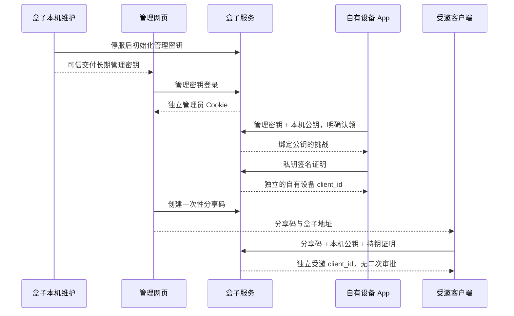
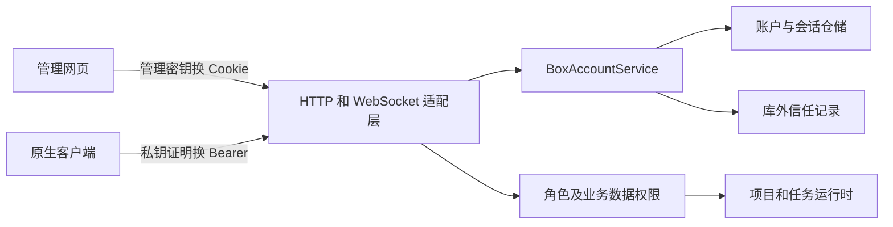

# 盒子账户技术设计与实施说明

更新：2026-11-02。适用于 `account_mode=box_local`，认证模型版本为 2，客户端签名协议版本为 1，数据库版本为 63。默认 `account_mode=server` 保留既有多用户账户行为。

盒子的管理权归一位主人：长期管理密钥用于网页登录和原生自有设备登记；其他客户端通过一次性分享码加入，随后使用自己的密钥。网页会话与客户端授权分别管理。服务端和 Dashboard 已实现此模型，App 本轮仅更新接口文档，Swift/UI 尚未接线。

本文说明身份、生命周期、权限、存储、迁移与验收。请求字段、签名规则和客户端步骤见 [App 接口与接线文档](box-local-account-client.md)，完整 DTO 以部署实例的 `/api/openapi.json` 和 `/api/docs` 为准。原有文件名保留，供已有引用继续使用。

协议兼容：认证模型版本仍为 2，签名协议仍为 1；`GET /api/box/status` 新增 `multiple_owner_devices=true`。客户端不得再根据 `primary_client_id` 是否非空禁止添加自有设备。`primary_client_id` 已弃用，仅保留一个代表设备 ID，不用于授权或工具路由；实际权限取决于已认证客户端的角色。`GET /api/box/account` 的 `owner_client_ids` 返回活动自有设备列表（受邀端返回空列表）。

新客户端使用 `/api/box/owner-claims` 登记自有设备、`/api/box/clients/{id}/owner` 授予自有设备权限。旧 `/primary-claims` 保留为弃用的登记兼容入口。旧 `/clients/{id}/primary` 转移接口经管理员认证后返回 `410 box_primary_transfer_retired`，不改变任何设备权限；客户端必须显式使用新 `/owner` 接口授予共享访问，不能自动重放旧转移请求。界面将“主设备”改为“自有设备”，说明“共享我的项目和会话”；“受邀设备”继续说明独立空间。旧服务未返回多设备能力时，不承诺支持多台自有设备。

## 1. 产品模型

一台盒子只有一位主人。主人使用长期管理密钥登录后台，不需要用户名或管理员密码。每台自有客户端提交管理密钥并证明持有本机私钥，即可登记为自有设备。多台自有设备共享主人身份、项目与会话；浏览器单独登录管理，不登记为客户端。登记和网页登录均不消费管理密钥。

自有设备或网页管理员可以生成短期、一次性的分享码。其他客户端使用分享码及自己的密钥加入后即可使用，无需再审批。分享码只授予受邀访问，不授予网页管理权，也不等同于管理密钥。

| 对象 | 凭据 | 权限与数据 |
| --- | --- | --- |
| 网页管理员 | 管理密钥换取 HttpOnly Cookie 会话 | 主人的数据、盒子配置、分享、撤销、授予自有设备权限、管理密钥轮换。浏览器不登记为客户端。 |
| 自有设备 | 首次使用管理密钥；此后使用本机 P-256 私钥 | 主人业务身份，可创建分享码。敏感密钥维护和授予自有设备权限由网页管理员完成。 |
| 受邀客户端 | 一次性分享码；此后使用本机 P-256 私钥 | 独立访问身份，自己的项目、任务、附件和本机客户端工具；无管理权限，不自动共享主人历史。 |

“一位主人”指管理权归属；受邀访问使用内部无密码用户主键实现数据隔离，不引入注册、邮箱、用户名登录等产品流程。每个客户端仍保留独立的受邀身份记录；自有设备映射到同一个主人身份，受邀设备映射到自己的身份。将受邀设备设为自有设备后，其原受邀数据保留且不合并；本轮通过撤销授权移除设备，不提供降级回受邀身份的操作。

## 2. 管理密钥从哪里来

当前通过盒子本机的受信任维护终端生成。服务首次启动建立数据库与盒子身份后，停止本实例，执行 `octop box key init`，再启动服务。命令生成每盒独立的高熵随机管理密钥，标准输出只显示一次；数据库只保存摘要。密钥不通过匿名 HTTP 接口提供，不写入 URL，不保存在网页的 localStorage、sessionStorage 或 IndexedDB。

停止服务是为了让 CLI 独占与服务端相同的认证锁，避免同时修改数据库和库外信任记录。维护命令不是普通用户的远程登录接口。量产时可以将这一可信交付环节接入设备屏幕、受保护的激活材料等硬件流程，本轮不假定已有物理按钮或屏幕。

管理密钥长期有效，首次认领不会使它失效。忘记密钥时，可在受信任本机终端停服执行 `octop box key rotate`。这不是无需本机权限的远程找回。

凭据与会话的生命周期如下。长期管理密钥和分享码都由服务端使用安全随机数生成，数据库保存 SHA-256 摘要；原生私钥由客户端生成，不上传到盒子。

| 材料 | 有效期 | 用途与保存位置 |
| --- | --- | --- |
| 管理密钥 | 主动轮换前长期有效 | 主人安全保管；网页登录或自有设备登记时输入。 |
| 分享码 `secret` | 自生成起 2 天（48 小时），单次使用 | 只负责登记受邀客户端，不用于后续日常请求。 |
| 原生 P-256 密钥对 | 客户端授权有效期间 | 私钥存客户端安全存储；服务端保存公钥与指纹。 |
| 签名挑战 | 60 秒，单次使用 | 绑定盒子、动作、主体和参数，防止跨动作使用或重放。 |
| 原生访问会话 | 10 分钟 | Bearer 访问令牌；到期前用设备私钥重新签名换票。 |
| 网页管理员会话 | 24 小时 | 独立 HttpOnly Cookie；刷新会话会替换旧 Cookie 并撤销旧会话。 |

退出、角色变更、撤销、密钥轮换和服务重启也会按第 6 节规则提前结束相关会话。密钥长期有效不等于某次登录会话永久有效。

## 3. 网页登录与浏览器持久性

网页输入管理密钥后，服务端签发独立的管理员会话，通过 HttpOnly、SameSite=Strict Cookie 保存。生产 HTTPS 同时设置 Secure。Cookie 不包含管理密钥，页面 JavaScript不能读取它。

网页会话为 24 小时，关闭再打开浏览器时可以恢复尚有效的 Cookie。当前 Dashboard 不自动调用会话刷新接口。清除浏览器数据、使用无痕窗口、会话到期、服务重启、主动退出或管理密钥轮换后，需要重新输入仍有效的管理密钥。不能承诺浏览器存储永久不丢失，也无需把浏览器当作“最后一台设备”才能保留管理入口。

网页写操作校验严格同源与 CSRF token；下载、SSE、WebSocket使用同源 Cookie，不向 URL 添加访问令牌。浏览器只维护会话元数据，不生成配对私钥。App 的签名证明不能兑换网页管理员 Cookie。

## 4. 自有设备与分享流程

自有设备登记不再限制为一台，多个候选可分别完成持钥证明。每个客户端公钥仍唯一，单个候选与挑战仍只能消费一次。管理员也可以在网页将已加入的受邀客户端设为自有设备；已有自有设备不降级。

新生成的分享码有效期为 2 天（48 小时，172800 秒），从服务端生成时开始计算，只有一个客户端能消费。已签发分享码保留数据库记录的原到期时间，不因本次默认值调整自动延长或恢复有效。用户只需复制一段分享码；客户端另行保存已经确认的盒子地址与身份。分享码一旦绑定公钥就不能替换候选；重试保持 request ID、公钥、名称和平台一致。证明成功直接登记，原来的等待审批页面和审批协议退役。

自有设备登记的候选窗口仍为 5 分钟，签名挑战仍为 60 秒；这两类时限与分享码有效期独立。

## 5. 权限与数据边界

身份由服务端依据认证记录决定，不能根据客户端提交的 `platform`、设备名称或角色字段赋权。自有设备映射主人账户；受邀客户端映射其独立的普通用户。既检查接口权限，也按用户主键查询项目、任务和附件。

盒子模式下，受邀客户端只开放明确列出的业务接口和 Task WS 命令；其余管理、远程工作台、主机目录、系统配置等入口默认拒绝。资源目录只返回允许使用的模型和空的主机资源选项。

受邀项目不能绑定盒子上的任意目录，也不能通过任务选项启用主机插件、MCP、专家、子代理或 ACP 执行引擎。任务在独立空间内使用受限工具集；不允许盒子 shell、浏览器或远程 fetch 绕过数据隔离。本机客户端工具继续校验认证 client_id，与其他客户端的执行身份隔离。这是当前共享访问的功能边界，不声称已经提供任意不可信代码的系统级沙箱。

普通 `server` 模式不受这些盒子规则影响。

客户端缓存以 `GET /api/box/account` 返回的 `(box_id, instance_id, account_id)` 为数据归属范围。`client_id` 标识授权的客户端，`account_id` 标识本次业务身份；同一客户端切换自有设备角色时，业务身份可能改变。重新换票后必须重读账户信息，再切换项目、任务、附件和历史缓存，不能沿用之前身份的数据。

## 6. 撤销、授权与轮换

| 操作 | 结果 |
| --- | --- |
| 网页退出 | 撤销当前管理员会话；管理密钥和客户端登记保留。 |
| 客户端退出 | 撤销当前 native 会话；本机私钥仍可换取新会话。 |
| 网页撤销客户端 | 撤销该客户端全部会话和未完成授权，拒绝后续换票；不删除业务数据。允许撤销最后一台客户端。 |
| 网页设为自有设备 | 只改变目标客户端角色，并撤销该端原会话和未使用分享材料；重新换票后访问主人数据。其他自有设备及受邀设备不受影响，原受邀数据不合并。重复授权不撤销新会话。 |
| 轮换管理密钥 | 旧密钥、所有管理员会话和全部未完成授权失效，包括分享材料与待完成自有设备认领；默认保留客户端登记及原生会话。可选择同时撤销所有客户端。 |
| 本机升级旧模型 | 校验原信任记录后，保留主人和业务数据，撤销旧客户端、会话及分享材料，初始化管理密钥。不会将旧浏览器自动指定为自有设备。 |

HTTP 下次鉴权拒绝失效会话；WebSocket和长响应持续重验；Task受理及客户端工具执行入口保留领域级授权校验。撤销不能回滚已经受理或已经执行的动作。

撤销后通过分享码用新公钥重新加入，会创建新的受邀身份。原受邀数据仍保留，但不会自动关联到新身份；当前没有恢复原受邀身份或合并历史的接口。主人使用管理密钥登记新的自有设备，仍可访问原来的主人项目和会话。

## 7. 数据结构与可信升级

061保留旧配对表；062加入管理密钥、客户端角色、受邀身份及独立管理员会话表；063移除活动 `primary` 角色的唯一索引。SQLite与PostgreSQL维护对应迁移。升级保留原有设备、密钥、业务数据与库外信任记录，不需要重新认领。

库外信任记录 v2覆盖管理密钥摘要/版本、自有设备、客户端公钥、角色、用户映射和关键权限。数据库恢复不能静默恢复已撤销访问权；信任不一致时关闭认证并要求可信本机维护，不能自动降级成未认领。

已运行061的实例必须停服备份，再显式执行 `octop box key init --upgrade-legacy`。升级前验证v1信任记录，升级后生成v2；若v1记录已损坏或与数据库不符，不把升级命令当作绕过校验的恢复入口。普通多用户服务器仍不支持直接改配置自动迁移为盒子。

### 7.1 持久化对象

| 对象 | 主要内容 | 约束 |
| --- | --- | --- |
| `box_account` | 主人用户、自有设备引用、管理密钥摘要及版本、认证模型版本、授权版本与信任摘要 | 单例；没有自有设备时仍可保留管理密钥和主人。 |
| `box_paired_clients` | 客户端 ID、公钥和唯一指纹、角色、独立受邀用户、活动或撤销状态 | 允许多个活动 `primary`（兼容协议中的自有设备角色）；被撤销公钥不能重新登记。 |
| `box_pairing_grants` | 分享摘要、请求标识、候选公钥、有效期和消费结果 | 同一材料只能绑定一个候选并消费一次；不再进入审批流程。 |
| `box_auth_challenges` | 签名载荷、动作、参数、主体、公钥、有效期与消费时间 | 每次证明消费一条挑战。 |
| `box_auth_sessions` | 原生客户端、实际业务用户、角色快照、启动标识、有效期与撤销时间 | 请求时重新校验会话与客户端当前状态。 |
| `box_admin_sessions` | 管理员、管理密钥版本、启动标识、有效期与撤销时间 | 不依赖客户端记录，不登记为设备。 |
| `users` | 一位主人和各客户端的内部受邀身份 | 复用业务数据归属主键，不暴露注册或用户名密码登录流程。 |

DDL 分别位于 [061 基础表](../src/octop/infra/db/migrations/061_box_accounts.sql) 、[062 管理身份增量](../src/octop/infra/db/migrations/062_box_management_identity.sql) 和 [063 多自有设备](../src/octop/infra/db/migrations/063_multiple_owner_devices.sql)，各自有对应 `.pg.sql`。旧状态枚举保留用于升级兼容，不代表旧审批能力仍可调用。SQLite 迁移通过幂等补列处理物理结构已升级但版本记录较旧的数据库；重复迁移不重置现有授权数据。

### 7.2 库外信任与恢复限制

`OCTOP_HOME/box-auth/trust.json` 保存授权状态的版本与摘要，`trust-intent.json` 记录尚未完成的授权变更。授权变更同时维护数据库与库外记录；启动发现不一致或未完成记录时拒绝继续认证，不自动接受较旧的数据库状态。

普通备份恢复入口会拒绝替换已有盒子授权状态，也会拒绝导入包含盒子状态的快照，返回 `box_restore_requires_recovery`。当前没有完成协调数据库、盒子身份和库外信任的通用恢复工具；`key rotate` 和 `--upgrade-legacy` 都不能绕过损坏的信任记录。不要删除信任文件来重新开放认领。

## 8. 接口职责与客户端流程

| 场景 | 主要接口 | 调用规则 |
| --- | --- | --- |
| 发现盒子状态 | `GET /api/box/status` | 无需会话；`claimed` 表示管理密钥已配置，多设备能力看 `multiple_owner_devices`，授权后的完整自有设备列表看 account 的 `owner_client_ids`。 |
| 网页登录与恢复 | `POST /api/auth/browser/sessions`、`GET /api/auth/browser/session` | 登录提交 `management_key`；返回管理员元数据，登录通过响应 Cookie 建立会话。 |
| 网页续期与退出 | `POST /api/auth/browser/refresh`、`DELETE /api/auth/browser/session` | 使用当前 Cookie、同源 Origin 和 CSRF token。 |
| 自有设备登记 | `POST /api/box/owner-claims`、`POST /api/box/pairings/{id}/proof` | 管理密钥授权候选；成功持钥证明才登记新的自有设备，不影响已有设备。 |
| 邀请客户端 | `POST /api/box/pairing-grants` | 网页管理员以 Cookie 和 CSRF 调用；自有设备以 Bearer 和新鲜 `enroll` 动作证明调用。 |
| 受邀客户端加入 | `POST /api/box/pairings`、`POST /api/box/pairings/{id}/proof` | 分享码绑定公钥；证明成功立即登记 `guest`，无需审批。 |
| 响应丢失恢复 | `POST /api/box/pairings/{id}/result` | 候选签署新的 `result` 挑战后查询原结果，不重复登记客户端。 |
| 原生登录或续期 | `POST /api/auth/challenges`、`POST /api/auth/sessions` | 私钥签署 `session` 挑战，取得 10 分钟 Bearer。 |
| 读取访问身份 | `GET /api/box/account` | 读取角色、当前用户、自有设备及缓存归属标识。 |
| 管理设备 | `GET /api/box/clients`、`POST /api/box/clients/{id}/revoke`、`POST /api/box/clients/{id}/owner` | 管理员和自有设备可读列表；撤销与指定自有设备仅网页管理员可执行。 |
| 轮换管理密钥 | `POST /api/box/management-key/rotate` | 仅网页管理员；新密钥一次展示，旧网页会话失效。 |

签名使用 P-256/ES256，客户端必须核对挑战中的盒子、主体、动作和参数摘要符合当前意图；请求的 `platform`、名称或自报角色不参与赋权。新客户端加入只需用户输入一段分享码，盒子地址和公钥等协议字段由客户端维护，不让用户复制整份 JSON。

默认连接使用 HTTPS/WSS；HTTP/WS 允许实际回环连接的本机开发。只能提供HTTP的部署可通过服务端 `box_http_origins` 明确列出允许的HTTP源（局域网与公网映射可分别列出），重启后启用兼容模式；默认空列表不开放远程HTTP，不能通过转发头启用。该列表不是网络访问控制，也不提供传输加密，管理密钥、会话和业务内容仍有被截获或修改的风险。网页 Cookie 写操作仍要求同源 Origin 和 `X-Octop-Box-CSRF`；安全读取接受同源 Origin、Fetch Metadata 或 Referer。Cookie 名称由盒子 ID 派生，Cookie 与原生 Bearer 不能互相替代。客户端配置及风险说明见[接线文档](box-local-account-client.md#3-传输与持钥证明)。

Task WebSocket 在握手阶段使用原生 Bearer 或同源网页 Cookie 完成认证，然后直接返回 `ready`。不使用 URL 中的 `token`/`access_token`，不再发送旧 `authenticate` 首帧。长连接和长响应会持续重验授权；客户端工具还必须绑定当前认证的 `paired_client_id`。

## 9. 实现模块

| 实现位置 | 职责 |
| --- | --- |
| [领域服务](../src/octop/infra/auth/box_accounts/service.py)、[签名处理](../src/octop/infra/auth/box_accounts/crypto.py)、[信任记录](../src/octop/infra/auth/box_accounts/trust.py) | 生命周期、事务、持钥证明、会话重验与信任一致性。 |
| [账户仓储](../src/octop/infra/db/repos/box_accounts.py)、[迁移适配](../src/octop/infra/db/migrate.py) | SQL 持久化、原子消费、多个自有设备与幂等升级。 |
| [HTTP 路由](../src/octop/api/routers/box_accounts.py)、[账户中间件](../src/octop/api/middleware/box_accounts.py)、[传输与权限检查](../src/octop/api/common/box_auth.py) | DTO、Cookie、Origin、CSRF、身份注入及访客入口限制。 |
| [访客执行策略](../src/octop/infra/projects/box_guest_policy.py) | 配置检查、工具集合限制及执行前重验。 |
| [本机维护命令](../src/octop/cli/commands/box.py) | 停服后初始化或轮换管理密钥、显式升级旧配对模型。 |
| [网页接口模块](../dashboard/src/api/modules/boxAccounts.ts)、[连接页面](../dashboard/src/pages/BoxConnect/)、[设备管理](../dashboard/src/pages/BoxDevices/) | 管理登录、Cookie 恢复、邀请、撤销、自有设备指定与密钥轮换。 |

HTTP 适配层调用领域服务，领域规则不放入页面或路由。同步数据库和认证操作由 API 在事件循环外调用。正常服务器模式通过同一套业务服务保留原有权限行为。

## 10. 运维与故障处理

命令必须在盒子主机执行，使用与服务相同的 `OCTOP_HOME`、配置和数据库。下表中的命令都要求先停止该实例并取得认证维护锁；执行完成后再启动服务。

| 场景 | 操作 | 影响 |
| --- | --- | --- |
| 新盒子第一次启用 | 首次启动建立身份和库外信任，停服执行 `octop box key init` | 生成主人和长期管理密钥；不创建自有设备。 |
| 已运行旧 061 模型 | 保留备份，停服执行 `octop box key init --upgrade-legacy` | 校验旧信任，保留主人业务数据，撤销旧授权并发放新管理密钥。 |
| 忘记管理密钥 | 停服执行 `octop box key rotate` | 发放新密钥，撤销网页会话和全部未完成授权，默认保留客户端。 |
| 需要全部重新授权 | 停服执行 `octop box key rotate --revoke-clients` | 同时撤销所有客户端，之后重新认领和邀请。 |

网页管理员也可以直接轮换密钥，无需停服。轮换成功后网页退出旧会话，保存一次展示的新密钥后重新登录。

认证失效时先区分材料和身份：会话到期可以重新换票；设备被撤销需要重新登记；授予自有设备权限需要重新读取角色并切换缓存；分享码过期需要重新生成。HTTP `403` 表示权限或传输条件不满足，不应通过反复登录掩盖；旧审批入口返回 `410`，客户端应移除等待审批流程。信任不一致可能直接导致服务拒绝启动，不保证总能从状态接口获得恢复提示。

## 11. 验证记录

2026-11-02 多自有设备改动：`make all` 通过（7447 项通过、31 项跳过），31 项账户相关前端测试、TypeScript 检查和生产构建通过。完整检查使用已有依赖环境（`RUN="uv run --no-sync"`），本机回环端口测试在允许监听的本地环境执行。PostgreSQL 未做实机验证，迁移 SQL 已与 SQLite 保持一致。

定向回归覆盖：两台自有设备共享项目和任务历史、访客隔离、单设备撤销及 WebSocket 失效、同一主人下的客户端工具身份隔离、062 升级保留设备和信任记录、重复迁移、独立登记候选重试，以及旧主设备转移接口返回 410 且不改变权限。App 原生页面与远端部署不在此次验证范围。

以下为 2026-10-30 旧单主设备模型的历史验证记录，不代表 2026-11-02 多自有设备改动的验证结果；App 原生界面不在该次验证范围。

| 检查 | 结果 |
| --- | --- |
| `make all` | 格式、Ruff、mypy 和完整后端回归通过；7435 项通过、31 项跳过。 |
| 前端 | 账户相关 53 项测试通过；TypeScript 检查和生产构建通过。 |
| 旧数据库升级 | SQLite 重复补列与版本记录修复通过；重复迁移保留原授权、账户和会话记录。 |
| 本机 8090 实测 | 无设备时网页登录、自有设备登记、同一密钥继续网页登录、分享直接加入。 |
| 权限实测 | 受邀端不能读取主人项目、调用管理接口或绑定任意主机目录。 |
| 旧模型撤销与角色实测 | 当时单主设备转移使两端旧会话失效，相关 WS 以 4401 关闭；撤销最后主设备后网页仍可管理。多设备模型改为只使目标端旧会话失效。 |
| 重启与浏览器实测 | 页面重载恢复 Cookie；退出后同一管理密钥重新登录；服务重启使旧会话失效，原客户端私钥可重新换票。 |

核心回归位置：[账户领域](../tests/unit/auth/box_accounts/test_box_account_service.py)、[浏览器会话](../tests/integration/test_box_browser_sessions.py)、[账户集成](../tests/integration/test_box_accounts.py)、[访客权限](../tests/integration/test_box_guest_permissions.py)、[访客执行策略](../tests/unit/projects/test_box_guest_policy.py)、[备份恢复限制](../tests/unit/backup/test_box_restore.py)。

## 12. 当前范围之外的能力

App 原生页面和安全存储接线、同一个受邀人在多个客户端之间共享身份、旧多用户服务器自动迁移、物理按钮找回、盒子转让、恢复出厂以及协调库外信任的备份恢复工具，均不属于本轮实现。

多台自有设备共享同一主人业务身份，直接读取同一份服务端项目和会话；分享码仍只授予独立受邀身份。共享数据不等于共享设备私钥或客户端工具执行权，本机工具仍绑定各自的认证 client_id。
